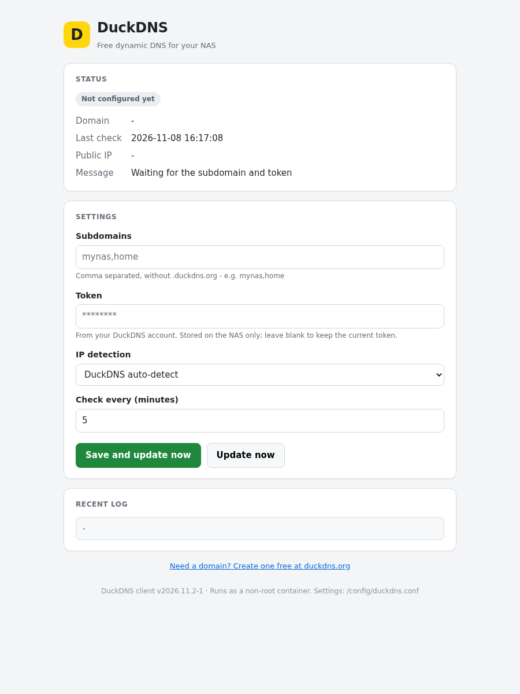

# duckdns-for-tos

> TerraMaster TOS 7 App Center — **Docker application** package for
> [DuckDNS](https://www.duckdns.org/), built on the official
> [LinuxServer.io image](https://github.com/linuxserver/docker-duckdns).

DuckDNS is a free dynamic DNS service. It keeps a hostname such as
`mynas.duckdns.org` pointed at the public IP of your NAS, so you can reach it
from anywhere even when your ISP changes that address. This package installs the
official DuckDNS client on TOS 7, keeps it running as an unprivileged container,
and adds a small local page for the initial setup and for checking the result of
the last update.



## What this is

A four-file TOS Docker application archive (`duckdnsdocker.tar.gz`):

- `config.ini` — TOS application metadata (`application_type: docker`, id `duckdnsdocker`)
- `duckdnsdocker.lang` — 23-language superset (TOS requires 14; en/zh-cn/zh-hk translated)
- `duckdnsdocker.svg` — application icon (12.1 KB; the DuckDNS duck mark)
- `docker-compose.yml` — one service, image `linuxserver/duckdns:aad9dc1f-ls96`

Two packages are published for this version — one per architecture the TOS store
accepts. Both contain the same four files; only `config.ini.platform` differs.

| Architecture | Package | Size | SHA-256 |
|---|---|---|---|
| x86_64 | `duckdnsdocker_x86_64.tar.gz` | 21270 B | `f93a9aba16e313e0a42ed192ab32f946ad9edbac22e3281a01aee4e88555739c` |
| aarch64 | `duckdnsdocker_aarch64.tar.gz` | 21271 B | `390aaa2cd5d81e278e51542f032835a104c076a43b6a8fc2c6d0651eee34cd05` |

## How it works

| | |
|---|---|
| Container image | `linuxserver/duckdns:aad9dc1f-ls96` (Docker Hub, used unmodified) |
| Open | `http://<NAS-IP>:8013/` (container port 8080) |
| Runs as | non-root, `user: "1000:1000"` |
| Persistent data | `/config` → `/Volume1/DockerAppData/duckdnsdocker/config` |
| Logs | `docker logs duckdnsdocker` (stdout/stderr) |

The container runs the image's own `/app/duck.sh` on a schedule (5 minutes by
default). The script calls the DuckDNS update API with the configured subdomain
and token and lets DuckDNS detect the public address — or, if you prefer,
detects the address through Cloudflare first (`ipv4` / `ipv6` / `both`). The
result is shown on the page and kept in `/config/status`; the last lines of the
updater output stay in `/config/duckdns.log`.

### First run

1. Create a free domain at <https://www.duckdns.org/> and copy its **token**.
2. Install the app from the TOS App Center and open it.
3. Enter the subdomain(s) without `.duckdns.org` (comma separated, e.g.
   `mynas,home`), paste the token, choose the IP-detection mode and save.
4. The page shows the last check, the detected public IP and the last result.
   The stored token is never echoed back into the form.
5. For access from outside your network, forward the ports you need on the
   router, or use a tunnel — DuckDNS only updates the DNS record.

## Design highlights

- **Non-root by construction.** `user: "1000:1000"`; the upstream image starts
  s6-overlay as root, so `src/entrypoint.sh` bypasses s6 and invokes the image's
  own `/app/duck.sh` directly. The container reports uid 1000 on real hardware.
- **Upstream client, not a reimplementation.** Every update is still performed
  by the image's `/app/duck.sh` with `SUBDOMAINS`, `TOKEN` and `UPDATE_IP`
  exported from `/config/duckdns.conf`; the wrapper only schedules it and
  reports the result.
- **A real page for a client that has none.** The image ships no web server and
  a TOS Docker app must open a page. The entrypoint serves a self-contained
  status and setup page with the busybox `nc` already present in the image — no
  extra container, no extra image, nothing installed at runtime.
- **Health check** probes `/healthz`; it stays healthy while DuckDNS is
  unconfigured or the last update failed, so a DuckDNS outage cannot get the app
  disabled by the platform.
- **No secret in the package.** The subdomain and token live only in the mounted
  data folder (`/config/duckdns.conf`, mode 600), never in the compose file.
- **Fixed image tag, never `:latest`**, Docker Hub only, no `privileged`, no
  `network_mode: host`, no Docker socket, no `cap_add`.
- **Deterministic build**: GNU tar with uid/gid 0 and zeroed timestamps, gzip
  without a timestamp, plus the review-standards self-check below.

## Runtime file manifest

Everything the application writes on the NAS lives inside its own data folder;
the container-internal `/tmp` is discarded with the container. Nothing else is
written.

| Path | Purpose | Created when | Growth bound | Lifecycle |
|---|---|---|---|---|
| `config/duckdns.conf` | subdomain(s), token, IP-detection mode and check interval (mode 600) | first start (empty template), filled in on the setup page | static | never overwritten; back it up with the config folder |
| `config/duckdns.log` | output of the last update runs | first start | rotated to the last 200 lines | safe to delete; rebuilt automatically |
| `config/status` | state, timestamp, IP and message of the last update | first start | one small file | overwritten after every run |
| `config/www/handler.sh` | the request handler for the local page (generated at start) | first start | static | rebuilt on every start |
| `/Volume1/DockerAppData/duckdnsdocker/config` | DuckDNS application data (everything the container writes outside /tmp) | on first start / on demand | bounded by your own data | persistent; kept on uninstall unless you ask to delete it |

Copying the `config` folder is a complete backup. The token in
`duckdns.conf` is a secret: the folder is readable only by the application user.

## Architectures

The TOS store accepts **one package per architecture**, and `config.ini.platform`
must match it character for character. Both packages are produced from the same
sources in one run:

```bash
scripts/build-dual.sh             # aarch64 + x86_64, both suffix-named + .sha256
```

The x86_64 package was verified with the full on-device E2E (17 checks, including
the official installer, non-root uid, volume ownership, restart and reinstall).
The aarch64 package passes the official `TOSAppSelfTestingTool -c` check and the
developer platform's automated validation; no ARM host with DockerEngine was
available for a container E2E, so that is declared here rather than claimed.

## Build

```bash
scripts/build.sh                  # one architecture -> out/duckdnsdocker.tar.gz + .sha256
scripts/build.sh 2026.11.2-2      # packaging iteration bump
scripts/build.sh 2026.11.2-1 aarch64
```

The build stages the four files, substitutes the version/platform placeholders,
embeds `src/entrypoint.sh` into the compose file (escaping every `$` as `$$`),
removes CRLF/BOM/AppleDouble, then runs `tools/verify.py`, a review-standards
self-check (archive layout, JSON validity, required fields, 14+ language
coverage, version consistency, Docker-Hub-only images, fixed tag,
reserved/recommended host ports, non-root user, per-service
healthcheck/TZ/restart, data path below the application data root, never the
`/Volume*` wildcard, comment-free sequence blocks, `x-app-meta` position, no
literal secrets and the SVG size/element limits).

## Local verification

```bash
./TOSAppSelfTestingTool -c out/duckdnsdocker.tar.gz -l zh-cn   # official spec check
bash test/install-and-verify.sh                                # on-device E2E (needs root)
```

> Docker applications cannot be side-loaded through the App Center's manual
> install page (it accepts `.deb` only); the official self-testing tool's `-i`
> mode or `docker compose` are the only ways to install one for testing.

## Versioning

Upstream publishes no semantic version for the DuckDNS client: the image tag is
a commit-plus-build identifier (`aad9dc1f-ls96`). This package therefore uses
the image build date as its upstream base (`2026.11.2`, image built on
2026-11-02) plus the packaging iteration (`-1`). The image itself is pinned by
its immutable tag and is never `:latest`.

## Store submission

1. Public GitHub repo (code + README only).
2. Release **tag `v2026.11.2-1`**, assets `duckdnsdocker_x86_64.tar.gz` and
   `duckdnsdocker_aarch64.tar.gz` (each with a `.sha256`). The unsuffixed
   `duckdnsdocker.tar.gz` is the x86_64 package kept for the already-submitted
   x86_64 version (identical bytes).
3. Developer platform → two App records with the same ID `duckdnsdocker`
   (package type Docker, same repository URL): architecture `x86_64` and
   architecture `aarch64`. Each record gets its own version and asset URL.
4. Version Management → Add Version `2026.11.2-1` for **each** record → automated
   validation → review.

## License / branding

The DuckDNS client is distributed by LinuxServer.io under **GPL-3.0-only**. The
container image is the official image from Docker Hub
(`linuxserver/duckdns:aad9dc1f-ls96`) and is used unmodified; no upstream source
code is redistributed here. The icon is the DuckDNS duck mark, used only to
identify the service this package configures. This packaging is an independent
community submission by Moechz and is not affiliated with DuckDNS, LinuxServer.io
or TerraMaster.

## Limitations

- The app only updates the DuckDNS record. It does not open firewall ports, so
  remote access still needs port forwarding or a tunnel.
- Outbound HTTPS to `www.duckdns.org` is required; the optional Cloudflare
  IP-detection modes also need access to `1.1.1.1` / `2606:4700:4700::1111`
  over DNS.
- The page is plain HTTP on the LAN and has no login. Do not publish the port to
  the internet.
- The DuckDNS token is stored in plain text in the application data folder,
  readable only by the application user (mode 600). Treat the folder as a secret
  and back it up accordingly.
- One DuckDNS token per instance. Several subdomains under that token can be
  updated together.
- Docker applications cannot be upgraded in place in the App Center: updating
  means uninstalling and reinstalling, which keeps the data folder.

---

Packaged for TOS 7 by Moechz. Upstream image used unmodified from Docker Hub.
